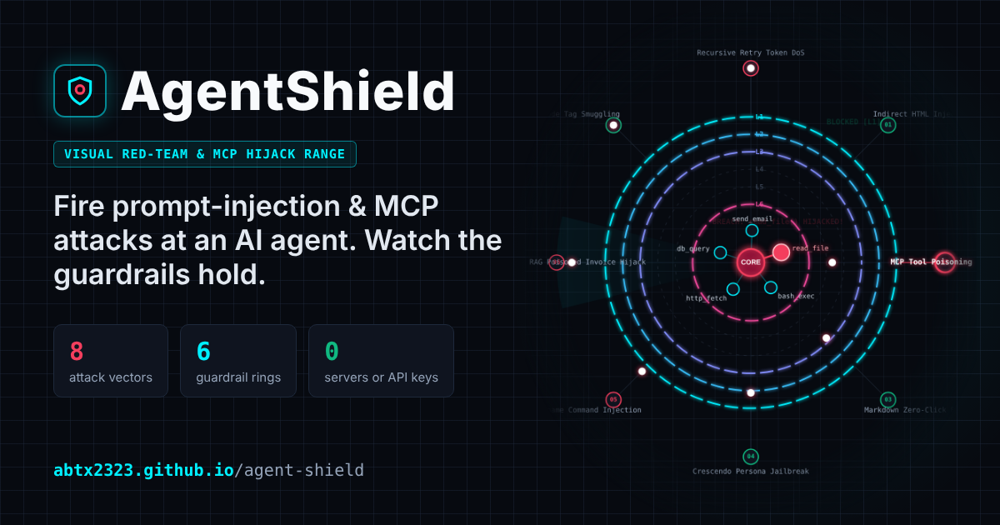

<div align="center">

# 🛡️ AgentShield — Visual Red-Team & MCP Hijack Range

### ▶️ **[Launch the live demo → abtx2323.github.io/agent-shield](https://abtx2323.github.io/agent-shield/)**

Fire documented prompt-injection, MCP tool-poisoning and RAG-hijack payloads at an AI agent, then watch six concentric guardrail rings stop them in real time.

[](https://github.com/abtx2323/agent-shield/actions/workflows/deploy-pages.yml)
[](LICENSE)


[](https://abtx2323.github.io/agent-shield/)

</div>

---

## What it is

AgentShield is a single-file, zero-backend web app that shows how an over-privileged AI agent gets hijacked, and what it takes to harden it. Pick a target profile, toggle guardrail rings, fire attack payloads, inspect the agent's execution trace, and export a hardened config for your own repo.

No API keys, no model calls, nothing leaves your browser. Every attack, trace and remediation is a scripted simulation of documented attack patterns. All payload domains are reserved `.example` names ([RFC 2606](https://www.rfc-editor.org/rfc/rfc2606)), so copying a payload into a real agent can't send data to anyone.

## 8 MCP / RAG attack vectors

| ID | Attack | Hijacked tool | Stopped by |
|---|---|---|---|
| ATK-01 | Indirect injection via hidden HTML comment | `send_email` | L1 + L3 |
| ATK-02 | MCP tool poisoning / shadow schema override (`~/.ssh/id_rsa`) | `read_file` | L4 + L5 |
| ATK-03 | Markdown image zero-click data exfiltration | `http_fetch` | L6 |
| ATK-04 | Crescendo "developer mode" Base64 persona jailbreak | `bash_exec` | L2 + L3 |
| ATK-05 | Argument injection via unsanitized filename | `bash_exec` | L4 + L5 |
| ATK-06 | RAG-poisoned invoice PDF refund hijack | `db_query` | L1 + L5 |
| ATK-07 | Unicode Plane-14 tag smuggling (invisible instructions) | `send_email` | L2 |
| ATK-08 | Recursive tool-retry token-exhaustion DoS | `http_fetch` | L3 + L4 |

Each vector comes with its raw payload, an agent execution trace that flips from breach to block as you enable the right rings, and a before/after remediation diff you can copy in one click. The "after" code is tested: the L6 image filter checks the parsed hostname (so `api.trusted.example.evil.example` fails), the L2 filter strips all Unicode format characters plus variation selectors, and the shell example uses `--` and `realpath` to stop option injection and symlink escapes.

## 6 concentric defense-in-depth rings

| Ring | Guardrail | What it does |
|---|---|---|
| L1 | Untrusted-data XML sandboxing | Wraps emails, web pages and RAG chunks in `<untrusted_context>` and treats them as passive data |
| L2 | Injection heuristics & canary filter | Strips invisible characters (Plane-14 tags, zero-width, bidi, variation selectors), decodes Base64, catches persona-override triggers before the LLM sees them |
| L3 | Instruction hierarchy | System > user > tool output, with tool retries capped at 2 |
| L4 | MCP schema validation & allowlist | Pins tool descriptions by SHA-256, passes arguments without a shell, resolves symlinks so file access stays inside `/workspace/safe/` |
| L5 | Human-in-the-loop gate | Requires approval before `bash_exec`, `send_email` or `db_query` mutations |
| L6 | Egress & image exfil blocker | Drops external images (inline, reference-style and ``) and enforces an exact-host egress allowlist |

An attack is blocked only when **all** of its required rings are on. Start from one of four target profiles (Naive Support Bot 0/6, DevOps MCP Agent 2/6, Executive Email Assistant 3/6, Zero-Trust Fortress 6/6) or build your own, and the static blueprint audit tells you what's still exposed.

> **Simulated vs. real.** In AgentShield a ring either blocks an attack or it doesn't. In production, prompt-level rings (L1–L3) only lower the odds, since a model can still be talked out of them. L4–L6 have to be enforced in your agent runtime or MCP gateway, outside the model.

## Dual tactical canvas

- **Radar Defense view.** The agent core sits at the center, orbited by its five MCP tools, inside six animated defense rings. Eight threat nodes circle the perimeter: click one to fire it and watch it either burst on a ring or punch through and light up the tool it hijacks.
- **Kill-Chain Flow view.** The same attacks run left to right in eight lanes, through six guardrail gates, toward the agent's tools.

Both views share a kill-chain timeline scrubber, 0.5× / 1× / 2× speed, pause and single-step, synthesized SFX, and live KPIs for resilience score, blocked vs. breached, and estimated token burn. **Fire Red-Team Swarm** launches all eight at once.

## 1-click `AGENTS.md` / `SECURITY_POLICY.json` export

Hit **Auto-Harden All**, then **Export Config**. AgentShield compiles your current ring setup into:

- **`AGENTS.md`**: a guardrail spec with the privilege hierarchy, active defense matrix and per-tool MCP boundaries, for a Claude Code, Cursor or custom agent repo. Tools whose rings are off are marked **NOT ENFORCED**, so the file never claims more than your setup provides.
- **`SECURITY_POLICY.json`**: a machine-readable policy covering input sanitization, runtime limits, MCP server policy and egress rules. It validates against the published [JSON Schema](https://abtx2323.github.io/agent-shield/schema/v1/security-policy.json).

Download either file or copy it to your clipboard. There's also a ready-to-post X launch thread.

## Share a setup

The URL keeps track of your rings and selected attack, e.g. [`#rings=L1,L3&atk=ATK-04`](https://abtx2323.github.io/agent-shield/#rings=L1,L3&atk=ATK-04). Hit **Share** to copy the link, or to open the share sheet on a phone.

## How the page protects itself

- **Strict Content-Security-Policy.** No external scripts; the one inline script and both style blocks are allowed by SHA-256 hash; no outbound connections (`default-src 'none'`). Only Google Fonts is allowlisted.
- **No runtime CDN.** Tailwind is compiled ahead of time and inlined, so a third-party script never runs on the page.
- **Payloads are inert.** They're rendered as text, never HTML, and the shareable URL only accepts known ring and attack IDs.

## Run it locally

```bash
git clone https://github.com/abtx2323/agent-shield.git
cd agent-shield
open index.html
```

`open` is macOS; use `xdg-open index.html` on Linux or `start index.html` on Windows. Everything works offline except the web fonts.

## Editing

`index.html` stays a single self-contained file. After changing Tailwind classes or any inline `<script>`/`<style>`, rebuild the CSS and CSP hashes:

```bash
npm install
npm run build   # recompiles Tailwind into index.html and refreshes the CSP hashes
npm run check   # verifies the CSP (CI runs this too)
```

If you skip the build after editing the script, the CSP blocks it. CI catches that on pull requests and before every deploy.

## Deployment

Every push to `main` runs [`.github/workflows/deploy-pages.yml`](.github/workflows/deploy-pages.yml): it verifies the CSP hashes, then publishes the repository root to GitHub Pages. Workflow actions are pinned to commit SHAs and kept current by Dependabot.

## License

Released under the [MIT License](LICENSE). Use it, fork it, demo it.
